### Hola, soy Luis 

Soy ingeniero de software y construyo **apps móviles y web completas**: diseño la interfaz, programo la lógica, armo la base de datos y la dejo funcionando en la nube. Me gusta resolver problemas de negocios reales con software que la gente de verdad usa, incluida la que no es experta en tecnología.

-  **Móvil:** apps Android nativas con Kotlin y Jetpack Compose, y multiplataforma con Flutter.
-  **Web:** frontends con React y Angular; APIs y backends con Node.js, PHP y Java.
-  **Nube y datos:** Firebase, MongoDB, Docker y arquitectura de microservicios.
-  **Me interesa:** aplicar inteligencia artificial a procesos del día a día.

---

### Proyectos

<table>
  <tr>
    <td width="50%" valign="top">
      <a href="https://github.com/luis16112004/GeoPulso-showcase">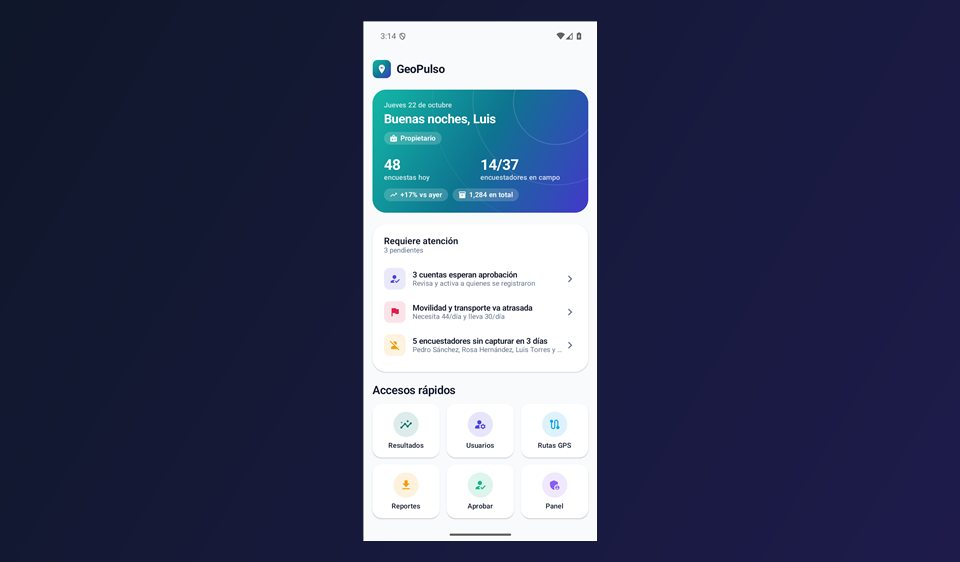</a>
      <h3>GeoPulso</h3>
      
App Android para equipos de encuestas en campo: captura sin conexión, rutas GPS, metas por cuadrilla, mapa de calor por municipio y distrito, y reportes en Excel y PDF generados en el teléfono.

      
  

      <a href="https://github.com/luis16112004/GeoPulso-showcase"><b>Ver el proyecto →</b></a>
    </td>
    <td width="50%" valign="top">
      <a href="https://github.com/luis16112004/DentalFlow">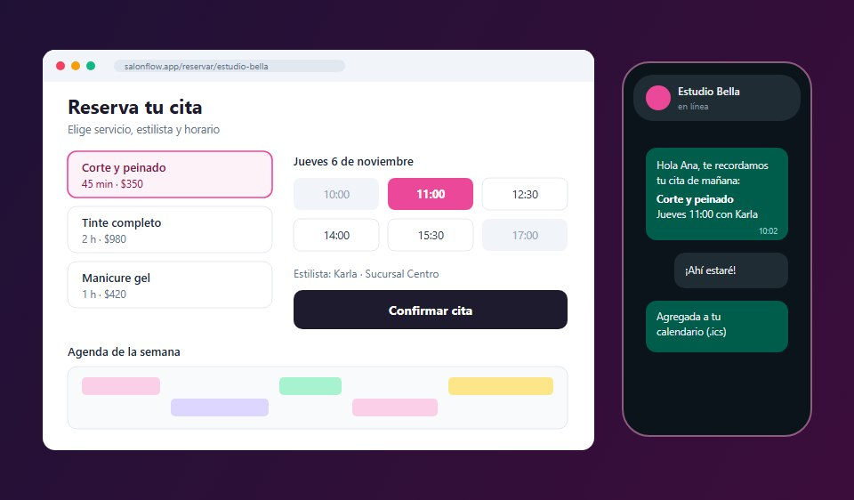</a>
      <h3>SalonFlow</h3>
      
Reservas en línea para salones de belleza: página pública para agendar, agenda por estilista, ficha de cada clienta y recordatorios por correo y WhatsApp. Incluye un bot de WhatsApp con IA.

      
   

      <a href="https://github.com/luis16112004/DentalFlow"><b>Ver el proyecto →</b></a>
    </td>
  </tr>
  <tr>
    <td width="50%" valign="top">
      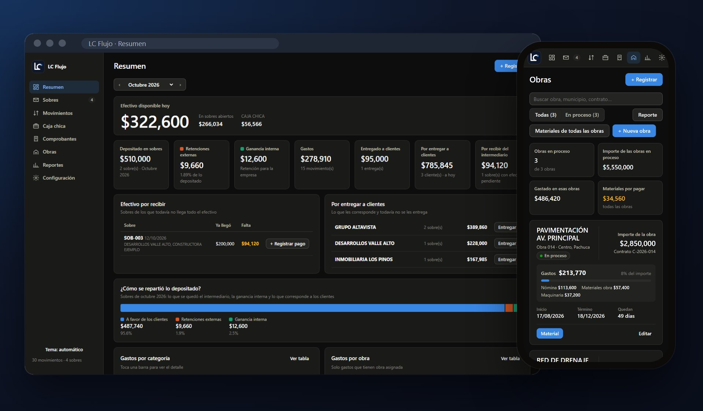
      <h3>LC Flujo</h3>
      
Control de efectivo para una constructora: sobres por obra, caja chica, comprobantes en PDF, materiales y reportes en Excel. Funciona en línea y también sin internet.

      
   

      Desarrollado para un cliente; el código y los datos son privados.
    </td>
    <td width="50%" valign="top">
      <a href="https://github.com/luis16112004/PuntoVentaLDC">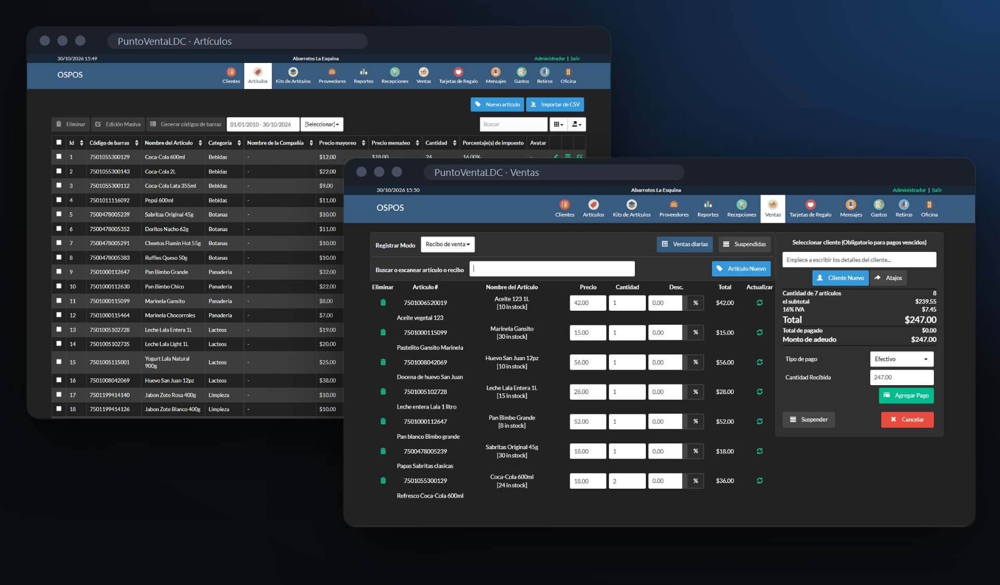</a>
      <h3>PuntoVentaLDC</h3>
      
Punto de venta para tiendas de abarrotes en México. Personalicé OpenSourcePOS con traducción completa al español de México, temas claro y oscuro, un registro de ventas más ágil y despliegue con Docker.

      
   

      <a href="https://github.com/luis16112004/PuntoVentaLDC"><b>Ver el proyecto →</b></a>
    </td>
  </tr>
</table>

---

### Páginas web

Sitios que he diseñado y desarrollado para negocios locales: restaurantes, consultorios, tiendas y eventos. Todos son responsivos y tienen contacto directo por WhatsApp.

<table>
  <tr>
    <td width="50%" valign="top">
      <a href="https://cafeteriazempoalli.com">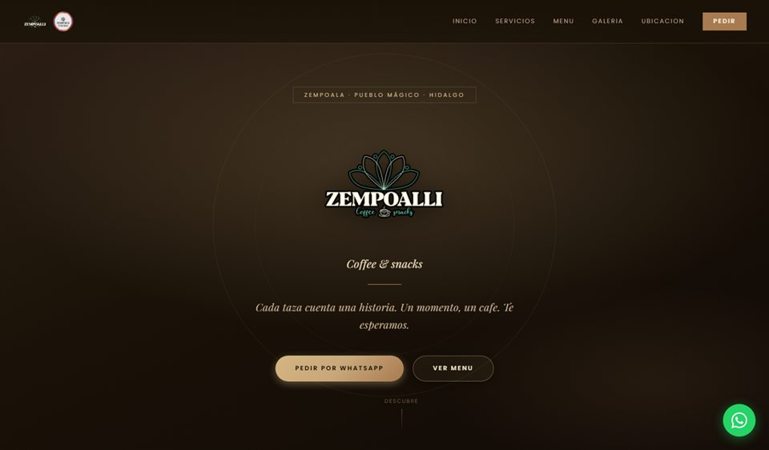</a>
      <b>Cafetería Zempoalli</b> · Cafetería 
      <a href="https://cafeteriazempoalli.com">cafeteriazempoalli.com</a>
    </td>
    <td width="50%" valign="top">
      <a href="https://nuevaimagen.com.mx">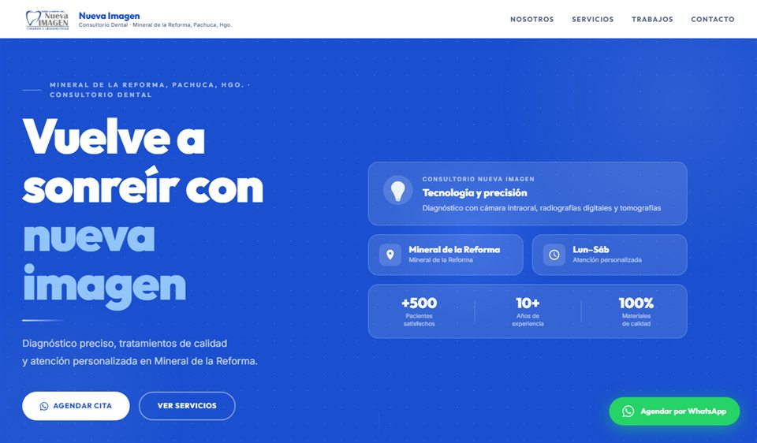</a>
      <b>Nueva Imagen</b> · Consultorio dental 
      <a href="https://nuevaimagen.com.mx">nuevaimagen.com.mx</a>
    </td>
  </tr>
  <tr>
    <td width="50%" valign="top">
      <a href="https://luis16112004.github.io/PaginasPerzonalizadaParaTuNegocio/">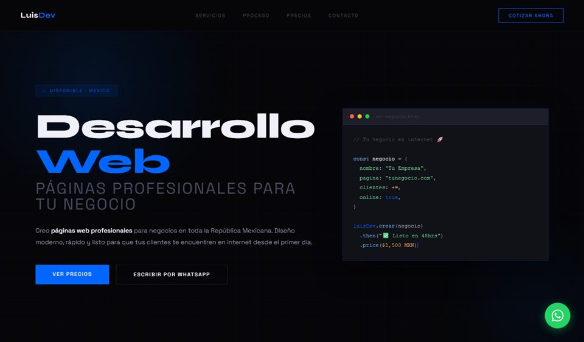</a>
      <b>Desarrollo web para tu negocio</b> · Mi página de servicios 
      <a href="https://luis16112004.github.io/PaginasPerzonalizadaParaTuNegocio/">Ver sitio</a>
    </td>
    <td width="50%" valign="top">
      <a href="https://luis16112004.github.io/PruebaChicagoBear1/">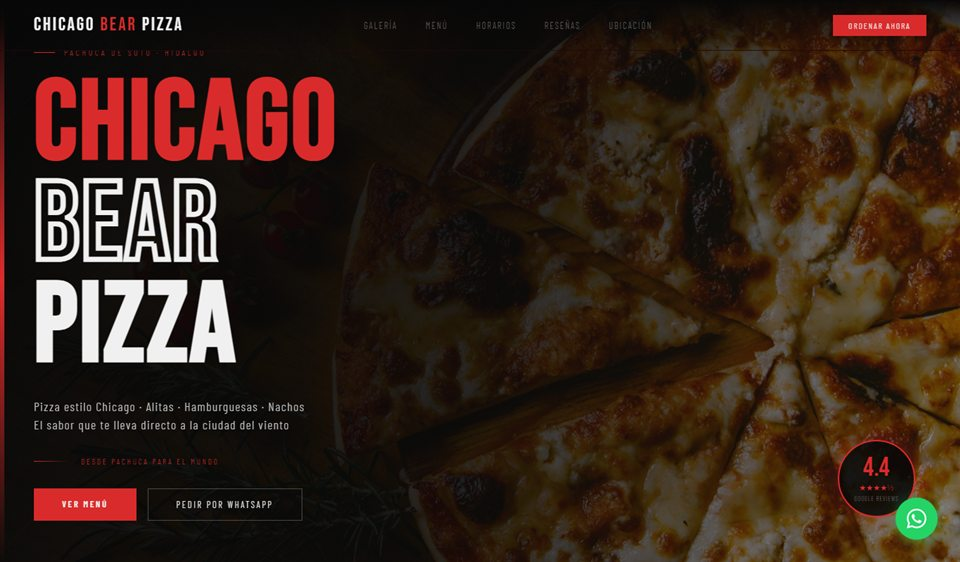</a>
      <b>Chicago Bear Pizza</b> · Pizzería 
      <a href="https://luis16112004.github.io/PruebaChicagoBear1/">Ver sitio</a>
    </td>
  </tr>
  <tr>
    <td width="50%" valign="top">
      <a href="https://luis16112004.github.io/PruebaLaMagia1/">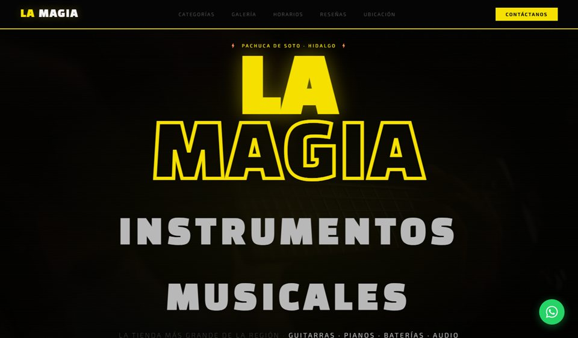</a>
      <b>La Magia</b> · Tienda de instrumentos musicales 
      <a href="https://luis16112004.github.io/PruebaLaMagia1/">Ver sitio</a>
    </td>
    <td width="50%" valign="top">
      <a href="https://luis16112004.github.io/CIREMONUMENTAL/">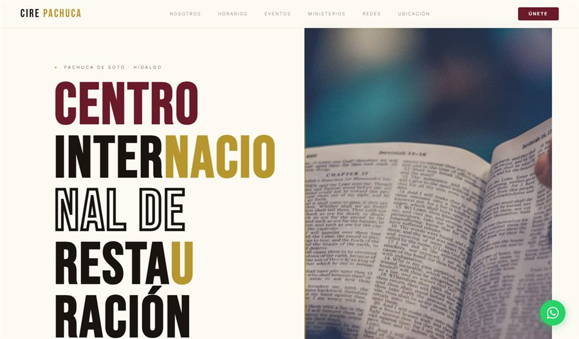</a>
      <b>CIRE Monumental</b> · Iglesia 
      <a href="https://luis16112004.github.io/CIREMONUMENTAL/">Ver sitio</a>
    </td>
  </tr>
  <tr>
    <td width="50%" valign="top">
      <a href="https://luis16112004.github.io/RinconDelAlmaPrueba4/">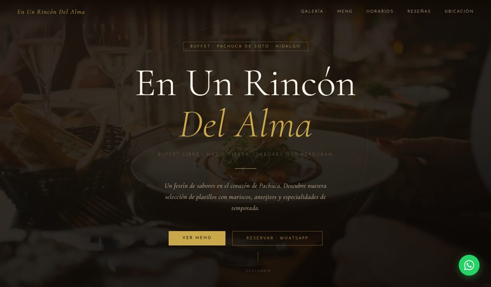</a>
      <b>En un Rincón del Alma</b> · Restaurante 
      <a href="https://luis16112004.github.io/RinconDelAlmaPrueba4/">Ver sitio</a>
    </td>
    <td width="50%" valign="top">
      <a href="https://luis16112004.github.io/PruebaSolyLuna/">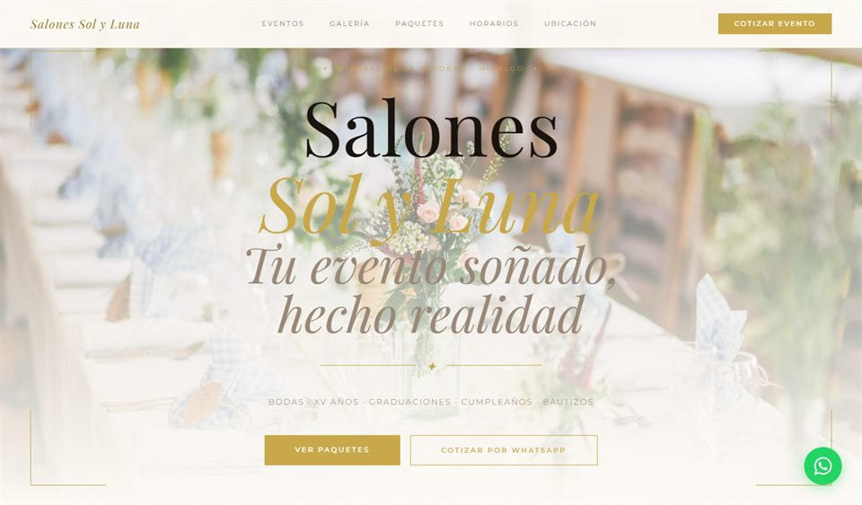</a>
      <b>Salones Sol y Luna</b> · Salón de eventos 
      <a href="https://luis16112004.github.io/PruebaSolyLuna/">Ver sitio</a>
    </td>
  </tr>
</table>

---

### Tecnologías con las que trabajo

**Móvil** 

**Web y backend** 

**Datos y nube** 

---

### Contacto

¿Tienes un proyecto o una vacante? Hablemos por LinkedIn:

También puedes revisar mis repositorios fijados para ver más de mi trabajo.
