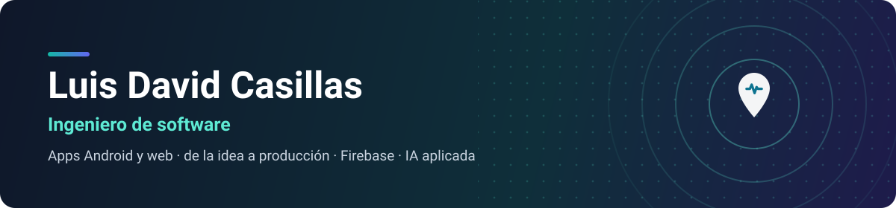

### Hola, soy Luis 

Soy ingeniero de software y construyo **apps móviles y web completas**: diseño la interfaz, programo la lógica, armo la base de datos y la dejo funcionando en la nube. Me gusta resolver problemas de negocios reales con software que la gente de verdad usa, incluida la que no es experta en tecnología.

-  **Móvil:** apps Android nativas con Kotlin y Jetpack Compose, y multiplataforma con Flutter.
-  **Web:** frontends con React y Angular; APIs y backends con Node.js, PHP y Java.
-  **Nube y datos:** Firebase, MongoDB, Docker y arquitectura de microservicios.
-  **Me interesa:** aplicar inteligencia artificial a procesos del día a día.
-  **Ahora mismo:** desarrollo **GeoPulso**, una app para equipos de encuestas en campo.

---

### Proyecto destacado

<table>
  <tr>
    <td width="62%" valign="top">
      <h3>
        
        GeoPulso
      </h3>
      
App Android para equipos de encuestas en campo: captura sin conexión, rutas GPS, metas por cuadrilla, mapa de calor por municipio y distrito, y reportes en Excel y PDF generados en el teléfono.

      

        
        
        
      

      <a href="https://github.com/luis16112004/GeoPulso-showcase"><b>Ver el proyecto →</b></a>
    </td>
    <td width="38%" valign="top" align="center">
      
    </td>
  </tr>
</table>

---

### Tecnologías con las que trabajo

**Móvil** 

**Web y backend** 

**Datos y nube** 

---

### Contacto

¿Tienes un proyecto o una vacante? Hablemos por LinkedIn:

También puedes revisar mis repositorios fijados para ver más de mi trabajo.
